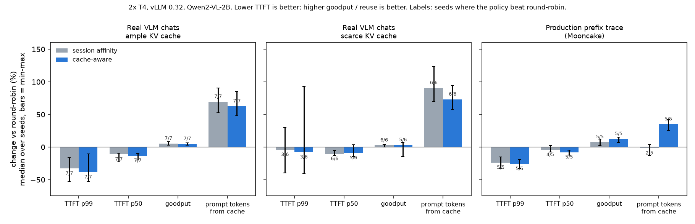

# kvsim: KV-cache-aware routing for multimodal LLM serving

A router that sits in front of several vLLM workers and sends each request to the GPU that
already holds the most of its prompt in KV cache, unless that GPU is too busy. Built from a
simulator, then measured on real GPUs with real vision-language chat traffic and a production
prefix trace.



**Results** (2x Tesla T4, vLLM 0.32, Qwen2-VL-2B; each comparison is paired within one seed and
session, numbers are medians and "n/n" is how many seeds agree):

* **Routing on cache state beats cache-blind load balancing on real VLM chats.** With an ample cache,
  keeping a conversation where its KV cache lives cut TTFT p99 by **33-38%** and p50 by 11-13% versus
  round-robin (7/7), with 63-70% more prompt tokens served from cache.
* **On a production trace where users share prefixes, cache-aware routing wins outright**: TTFT p99
  **-26%** and goodput **+12%** vs round-robin, and **+40% reuse** vs session pinning (5/5).
* **On chat traffic, simple session pinning is as good as cache-aware routing** (images almost never
  repeat across conversations). An apparent -8% p99 edge for cache-aware under a scarce cache did not
  replicate in a second session, and is reported as such.
* **Router v2** fixed two flaws measured in v1 (an estimate that ignored decoding requests; moves that
  threw away a still-cached conversation): harmful moves dropped from 4-16 to 2 per run and reuse rose
  13% under a scarce cache; its latency gain over v1 is within run-to-run noise.

Full tables, per-run details and what did not hold: [docs/phase3b.md](docs/phase3b.md).

## How it works

```
load generator ──► router (OpenAI-compatible proxy) ──► vLLM worker 0 (GPU 0)
 (real traces)        │                              └► vLLM worker 1 (GPU 1)
                      ├ hash the prompt into 16-token blocks (text + image ids)
                      ├ per-worker prefix index: what each GPU holds, incl. generated replies
                      ├ load: requests in flight, prefill backlog, scraped /metrics
                      ├ policy picks a worker; reply streams back unchanged
                      └ logs predicted vs actual cached tokens for every request
```

| policy | rule |
|---|---|
| round-robin, least-requests | cache-blind baselines |
| session affinity | a conversation stays on the GPU of its first turn |
| cache-aware (v1) | lowest estimated time to first token: prefill backlog + prefill of the uncached part (same code as the simulator's policy) |
| cache-aware v2 | v1 x (1 + 0.02 x requests in flight), plus a switching cost when the home GPU still holds the conversation |

The cost model is measured on the T4: prefill = 43 ms + n / 11,100 tok/s + a quadratic attention term
(3.2e-7 s x n x (cached + n/2)), image tokens ~5.9x a text token ([docs/phase2.md](docs/phase2.md)).

## Workloads

| | source | used for |
|---|---|---|
| **VisionArena-Chat** | real user-VLM conversations (LMArena, 199k total; runs sample from ~9k in 2 of 43 shards): real images, questions, turn counts; follow-ups carry the model's own replies | headline experiments |
| **ServeGen** (Alibaba) | real think time between turns (median 274 s; compressed 10x so runs fit a session) | timing |
| **Mooncake** (Kimi) | one hour of production requests with block hashes: prefix sharing across users, real arrival times | production pattern |
| synthetic | the original generator (3-8 turns, 2-6 images) | controlled sweeps |

Profiling the real data changed the picture: 78% of real VLM chats are a single question, images
almost never repeat across conversations, and real users think for minutes, so the best possible
reuse is ~0.2-0.3 of prompt tokens instead of the 0.86 the synthetic traffic implied.

## Methodology (what makes the numbers trustworthy)

* Every policy replays the **same trace** on the **same workers**; all caches (prefix, multimodal,
  encoder) are reset between policies; a warm-up replay runs first; the **policy order rotates** with
  the seed; comparisons are **paired** within a seed and session, over 2-7 seeds and 2 Kaggle sessions.
* **Validation fails a run** for errors, missing measurements, a cold request that hit the cache,
  unequal work across policies, unrealistic router estimates, or degenerate model output (an fp16
  sanity question is asked first). Validation caught a cost-model bug (image weight inside the
  quadratic attention term: estimates 9x too high), a tokenizer undercount on CJK text, and a
  keep-alive race in the proxy, all fixed and covered by tests.
* Run-to-run noise is measured, not assumed: between sessions, TTFT p99 moves ~7-14%, so smaller
  p99 differences are not claimed.

## Limitations

Two small GPUs (T4, no FlashAttention) and a 2B model; think times compressed 10x; the router's
view of each cache is built from its own routing decisions, so under a scarce cache it drifts
(87-91% of predictions within 5 points vs 99% otherwise); one router process. Next: an index fed by
vLLM's KV-cache events (Phase 4) and a batching-aware simulator for scale-out projections.

## Reproduce

```bash
pip install -e ".[dev,router,traces]"
pytest                                    # 81 tests, ~45 s, no GPU
# whole pipeline on mock workers (laptop)
python -m bench.mock_worker --n 2 --base-port 8001 --time-scale 10 --cache-blocks 3000 &
python -m deploy.kaggle_run phase3b --workload mooncake --external http://127.0.0.1:8001,http://127.0.0.1:8002 \
    --loads 1 --seeds 0 --duration 60 --warmup 10 --session-warmup 10 --time-scale 10 --out results/mock
```

GPU runs: [`deploy/kaggle_phase3b.ipynb`](deploy/kaggle_phase3b.ipynb) on a free Kaggle 2x T4 notebook.

## Repository

```
router/       the router: proxy, prompt hashing, prefix index, load signals, policies (v1, v2)
bench/        load generator, mock vLLM worker, trace builders (VisionArena, ServeGen, Mooncake), analysis
deploy/       vLLM launcher, calibration, experiment runner, validation, Kaggle notebooks, result sanitizer
kvsim/        the original discrete-event simulator (policies shared with the router)
results/      phase 2 calibration, phase 3 and 3b runs (sanitized), headline figure
docs/         per-phase write-ups
```

| phase | what | write-up |
|---|---|---|
| 0 | simulator + Ollama/M1 calibration | [docs/simulator.md](docs/simulator.md) |
| 1 | real-image workload, mock worker, load generator | [docs/bench.md](docs/bench.md) |
| 2 | vLLM on a T4: smoke checks, cost model | [docs/phase2.md](docs/phase2.md) |
| 3 | router on 2x T4, synthetic traffic | [docs/phase3.md](docs/phase3.md) |
| 3b | real traffic, scarce caches, seeds, router v2 | [docs/phase3b.md](docs/phase3b.md) |

## Data and licenses

VisionArena-Chat is used under LMArena's terms, which forbid redistribution: it is downloaded on
the GPU machine only, and committed results contain no prompts, images or model replies
(`deploy/sanitize_results.py`). ServeGen (Apache-2.0) and Mooncake (Apache-2.0) are credited where
used; only derived statistics are committed.
