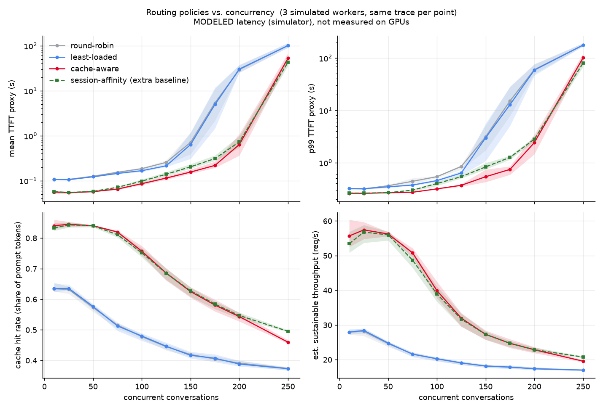
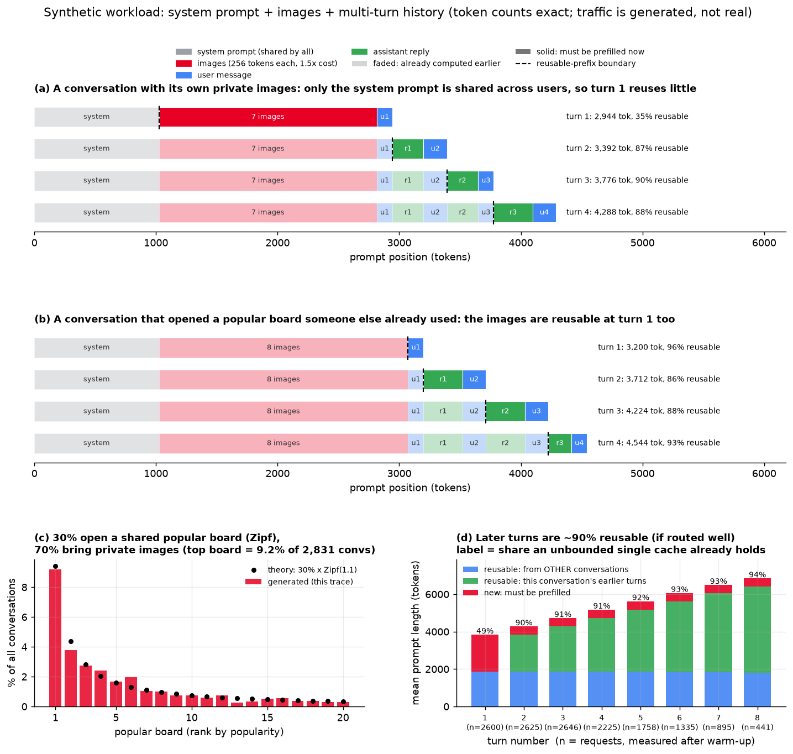
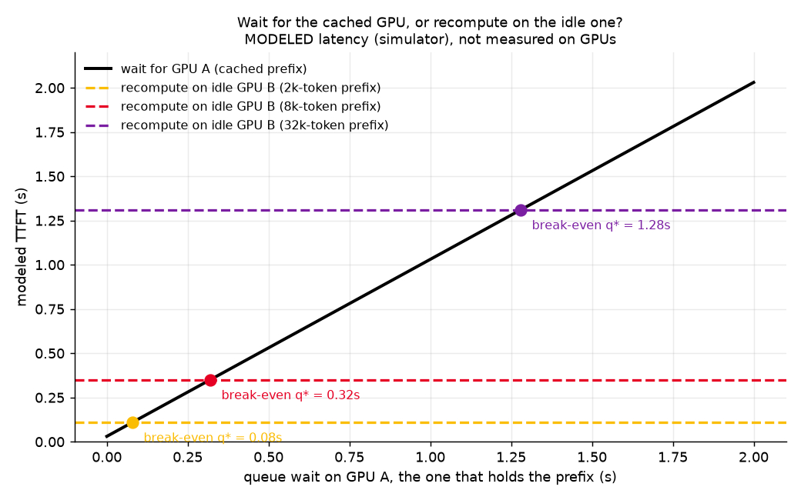
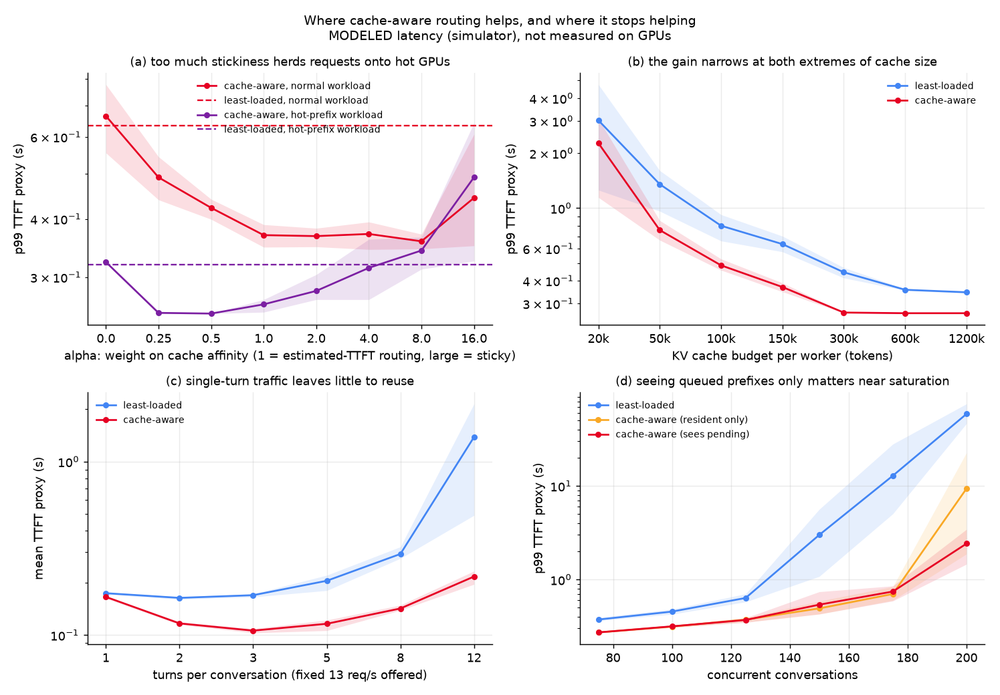
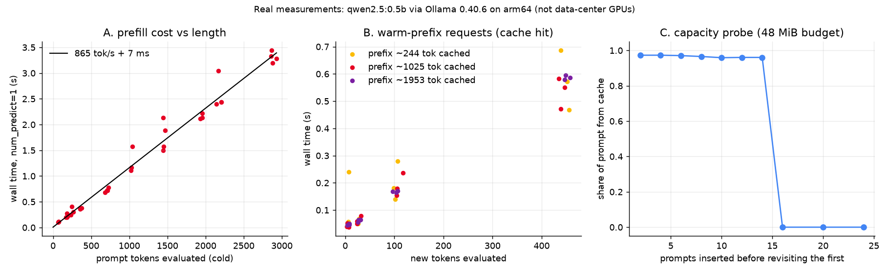
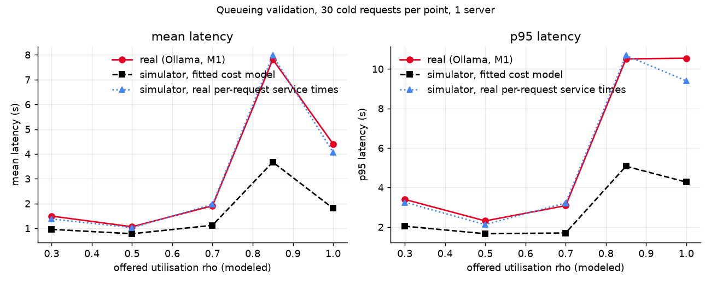
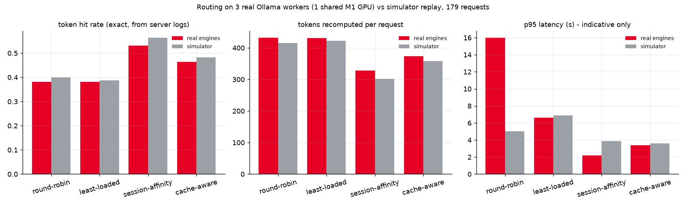
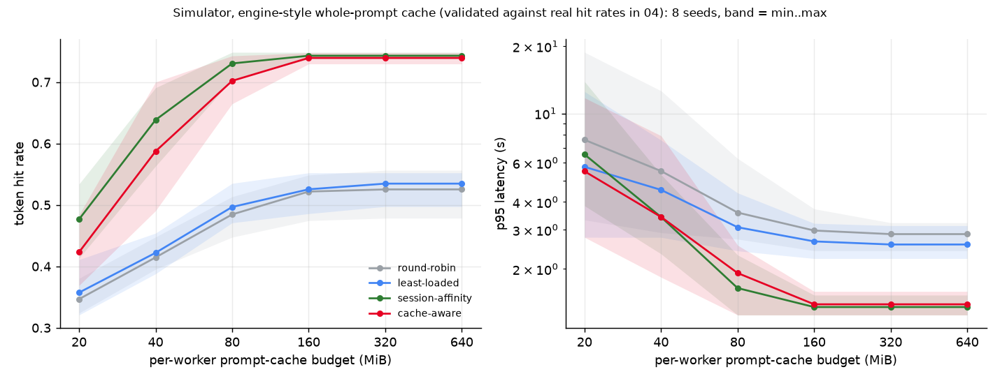

# kvsim: a mini KV-cache-aware router for multi-turn VLM traffic

A small, reproducible simulator that asks one question:

> In a multi-turn, image-heavy assistant, when is it worth sending a request to the GPU
> that already holds its prefix, and when is it better to recompute it somewhere idle?

It is inspired by the multimodal KV-aware routing described in
[Building Pinterest's VLM Serving Stack on NVIDIA Dynamo](https://medium.com/pinterest-engineering/building-pinterests-vlm-serving-stack-on-nvidia-dynamo-0dce6e93d0f3).
It is **not** a reimplementation of Dynamo's router (the post doesn't publish its scoring function).

> **Read this first: every latency in the main figures is *modeled*, not measured.**
> TTFT numbers are `queue wait + modeled prefill time` from the assumptions in
> [`kvsim/config.py`](kvsim/config.py) (data-center-like guesses, e.g. 25k tokens/s). They say how
> the policies *rank and scale* under those assumptions, not what a GPU would do. The simulator's
> mechanics have been checked against a real engine on a laptop (Ollama / llama.cpp on an M1,
> see [Calibration on a real engine](#calibration-on-a-real-engine)), which tested the cache,
> queueing and hit-rate models, **not** data-center GPUs or vLLM.



## Setup being simulated

* 3 simulated prefill workers (the P in a disaggregated E/P/D deployment). Each has a FIFO queue
  and a hard KV budget (150k tokens) with LRU eviction over 64-token blocks.
* Synthetic conversations: a shared system prompt, then a collection of 4-16 images (256 visual
  tokens each, 1.5x costlier to recompute than text), then 3-8 turns. Each turn's prompt is the
  previous prompt plus the reply plus a new message. 30% of conversations open one of 20 shared
  "popular boards" (Zipf popularity). Figure below: two example conversations, the Zipf board
  popularity, and how reusable the average prompt is at each turn.



*(Faded = tokens an unbounded single cache would already hold; solid = must be prefilled. That
ideal is an upper bound: the gap to it is what routing and finite caches lose.)*

* "Concurrency" = steady-state number of active conversations. Arrivals are open-loop and
  pre-generated from a seed, so **all policies see the identical request sequence**.
* Results are the mean of 3 seeds (bands = min..max). The first 120 s are warm-up and excluded.

### Policies

| policy | rule |
|---|---|
| round-robin | `i mod n` |
| least-loaded | worker with least outstanding work, counting every queued request as a full uncached prefill (what a cache-blind balancer can know) |
| cache-aware | `argmin_w  queue_wait(w) + alpha * est_prefill(request \| prefix cached on w)`, `alpha = 1` |
| *session-affinity (extra baseline)* | first turn to the least-loaded worker, every later turn pinned to that worker; never inspects the cache. Added because it is the obvious cheap alternative |

With `alpha = 1` the score is the **estimated TTFT on each worker**, so "wait for the worker with
the prefix or recompute on the idle one" falls out of the arithmetic. `alpha < 1` drifts toward
least-loaded; `alpha > 1` is increasingly sticky.

### Metrics (per policy)

Token hit rate, **recomputed prefix tokens** (split into *routing misses*, where the prefix was
cached on another worker, and *eviction misses*, where it was cached nowhere), mean/p50/p95/p99
TTFT proxy, throughput, estimated sustainable throughput (`workers / mean service time`), and
load imbalance. Full per-point numbers are in `results/*.json`.

## What the experiments show

**1. Cache-aware routing beats cache-blind routing at every load, and most near saturation.**
(means of 3 seeds, least-loaded -> cache-aware; round-robin is similar to or up to ~20% worse than least-loaded)

| concurrent convs | token hit rate | recomputed prefix tok/req | mean TTFT proxy | p99 TTFT proxy |
|---:|---|---|---|---|
| 10  | 0.64 -> 0.84 | 1016 -> 6    | 1.9x lower  | 1.2x lower |
| 100 | 0.48 -> 0.76 | 1830 -> 469  | 1.9x lower  | 1.4x lower |
| 150 | 0.42 -> 0.63 | 2144 -> 1118 | 4.1x lower  | 5.6x lower |
| 200 | 0.39 -> 0.54 | 2283 -> 1520 | 48x lower   | 24x lower  |

The big multiples at 150-200 are mostly the **saturation knee shifting right**, not a constant
speed-up. Cache hits are cheap in this model, so cache-aware routing needs less compute per request
and saturates later. Queueing is very nonlinear near saturation, so a small capacity gain looks
huge in p99. The honest headline is the low-load row and "the knee moves from roughly 125-150 to roughly 175-200 concurrent conversations".

**1b. Most of the hit-rate gain comes from simply keeping a conversation on one GPU.**
The dashed session-affinity baseline matches cache-aware on hit rate (0.75 vs 0.76 at N=100) and
sustainable throughput. Cache-aware routing's *extra* value shows up in the tail under load:
p99 of 0.32 s vs 0.40 s at N=100 and 0.54 s vs 0.83 s at N=150 (means of 3 seeds), because it also balances load
and reuses prefixes across conversations (system prompt, shared boards). In this model that
margin is real but modest, and it is bought with a router that must track every worker's cache. The
simulator has no worker failures, autoscaling or cache-affecting restarts, which are exactly
where pinning breaks down, so it may understate the gap in production (untested here).

**2. The kind of miss changes with load.** At 100 concurrent conversations most of
least-loaded's recompute is *routing misses* (1097 of 1830 tokens/req), which a router can fix.
At 200 most is *eviction misses* (1510 of 2283), which routing cannot fix: the cache is simply too
small for the working set. Cache-aware routing removes the routing part
(1097 -> 59 at N=100) and is then limited by capacity. This is where offload tiers (host RAM /
NVMe, e.g. LMCache) are the next lever.

**3. Waiting on the cached GPU is only right up to a break-even queue wait.**



If GPU A holds the prefix but has a queue, and GPU B is idle and cold, waiting is better only while
`queue_A < cost(re-prefill the prefix)`. With the assumed 25k tok/s that is ~0.08 s for a 2k-token
prefix, ~0.32 s for 8k, ~1.28 s for 32k. Longer prefixes justify more patience. The router flips at exactly this point
(checked in `tests/test_simulator.py` and `experiments/02_breakeven.py`).

**4. Where it stops helping or starts hurting**



* **(a) Stickiness hurts.** On a workload where 90% of conversations share 2 hot prefixes, an
  affinity-heavy router (`alpha = 16`) has ~1.5x *worse* p99 than plain least-loaded (0.49 s vs 0.32 s):
  it herds requests onto the GPUs that hold the hot prefix. `alpha` around 0.25-1 was best there.
  Scoring by estimated TTFT (`alpha = 1`) was never worse than least-loaded in these runs.
* **(b) Cache size.** The gain over least-loaded is ~1.7x on p99 for mid-size caches and narrows to
  ~1.3x at both extremes: tiny caches thrash for everyone, large caches let least-loaded eventually
  replicate prefixes on every worker.
* **(c) Reuse.** With single-turn conversations the two policies are within noise (0.17 s vs 0.17 s mean);
  the benefit comes from multi-turn reuse.
* **(d) Pending prefixes.** Letting the router see prefixes that are queued but not yet resident
  made little difference up to ~175 concurrent conversations (resident-only was marginally better
  at 150-175, within seed noise) and mattered near saturation (p99 9.4 s resident-only vs 2.4 s at 200).

## Limitations (what this does not model)

* **No data-center GPU numbers.** The main figures use assumed parameters. On the M1 the fitted
  prefill cost was linear with no significant attention term and hits were nearly free, but that
  is a 0.5B model on a laptop. No batching/chunked-prefill model.
* **Prefill only.** No decode, no encoder pool, no KV transfer between P and D workers; replies are
  re-prefilled on the next turn.
* **One cache tier.** No host-RAM/NVMe offload, so an eviction is a full recompute.
* **Perfect router knowledge.** The router sees every worker's cache instantly. A real indexer is
  fed by asynchronous KV events and can be stale; a real deployment may also run multiple routers.
* **Block granularity.** Prompts are rounded up to whole blocks, which slightly favors hits.
* **Synthetic workload.** Popularity, conversation length and think time are assumptions, and the
  strong results depend on how much real traffic looks like this.

## Calibration on a real engine

Hardware/software: **Apple M1, 8 GB**, Ollama 0.40.6 (which runs llama.cpp's `llama-server`),
`qwen2.5:0.5b`. Everything below is in [`calibration/`](calibration/) and is a laptop-scale check of
the simulator's *mechanics*. It says nothing about Blackwell GPUs, vLLM or Dynamo.

**What the engine exposes.** Ollama's `prompt_eval_count` includes cached tokens, so hit counts are
read from the server log (tokens cached vs. evaluated per request); latency is client wall-clock with
`num_predict=1`. Each experiment starts its own `ollama serve` processes with controlled settings.

| measurement | result (real, M1) |
|---|---|
| Prefill speed (cold prompts, 70-2900 tokens) | **~870 tokens/s**, linear in length (R2 ~ 0.98). Fixed overhead is small and fit-dependent (7-38 ms). A quadratic term added nothing |
| Cost of a cache hit | **nearly free.** 1953-token prefix + ~8 new tokens: **47 ms vs 2138 ms cold**. Identical re-send: 28 ms. The fitted attention term was not significant (so `attn_s_per_token_pair = 0`) |
| Cache structure | a **whole-prompt cache** (not block-level) restored by longest common prefix, evicted LRU under a byte budget: a sharp cliff, 14 prompts still hit and 16 missed at a 48 MiB budget, ~12.1 KiB/token (matches Qwen2.5-0.5B's KV size) |
| Queueing (1 server, Poisson cold arrivals, 5 loads) | The FIFO single-server model is right: replaying the simulator with the server's **real per-request service times matches measured latency within ~10%**. With only the fitted cost model it underestimates, because real service was 1.2-1.4x slower than fitted during the run |
| Routing on **3 real workers** (179 requests, 1 shared GPU) | simulator hit rates match the real ones within ~0.03 and the **hit-rate ranking is reproduced** (table below) |
| Image vs text token cost (moondream, ~730 image tokens) | A prompt with one image took 4.65 s vs 3.15 s for an equally long text prompt, so **`image_cost_multiplier` ≈ 1.48**, close to the 1.5 I had assumed. Re-asking a different question about the **same image** took 0.12 s instead of 4.1 s (732 of 741 tokens served from cache, ~33x faster), and two images cost about twice one (8.3 s vs 4.1 s), so cost is roughly linear in images. **Weak evidence:** one image size, one model, a handful of runs, a different model from the text fit (moondream text speed was only ~230 tok/s, and its fitted overhead came out negative, i.e. the line is noisy near zero). The multiplier is wall-clock including the vision encoder, which a real VLM server would run on a separate E/P/D stage |





### Real routing vs simulator replay

Three `ollama serve` workers, each with its own prompt cache (40 MiB budget) and serial execution,
driven by a thin router that reuses this repo's router classes. Same trace in the simulator,
using a new `SequenceCache` that models the engine's whole-prompt cache.

| policy | hit rate real / sim | recomputed tokens per request real / sim | p95 latency real / sim (indicative) |
|---|---|---|---|
| round-robin | 0.38 / 0.40 | 432 / 415 | 16.0 s / 5.0 s |
| least-loaded | 0.38 / 0.39 | 431 / 423 | 6.6 s / 6.9 s |
| session-affinity | 0.53 / 0.56 | 327 / 302 | 2.2 s / 3.9 s |
| cache-aware | 0.46 / 0.48 | 374 / 358 | 3.4 s / 3.6 s |



Raw per-worker server logs for this run (12 files; home path redacted) are in
[`calibration/results/logs/`](calibration/results/logs/): the hit counts above are parsed from them.
Other raw logs from the calibration scripts are regenerated when you run them and are not committed.

* **Token counts are reliable** (exact, from logs). **Latencies are only indicative:** the three
  workers share one GPU, so they contend; the simulator divides the prefill rate by 3 to approximate
  that and does not reproduce the latency ranking (round-robin vs least-loaded swap).
* **One trace, one run per policy.** Treat differences between policies as suggestive.
* **Speed drifted.** A pre-load check found the engine ~1.7-2.1x slower than the fit from an earlier,
  quieter session (a model download was running, and the laptop had been under sustained load). A
  cost model fitted in one session is a point-in-time value.

### An unexpected result: pinning beat cache-aware under this cache

On the real engines session-affinity had a higher hit rate than cache-aware (0.53 vs 0.46), and the
simulator predicted the same. To see whether that was a fluke, I swept the per-worker cache budget
over 8 seeds in the simulator (validated above, so a fair proxy; no GPU needed):



Under the engine's whole-prompt cache, session-affinity matched or beat cache-aware on hit rate at
every budget (cache-aware was higher in at most 25% of seeds) and the two converge once the budget
is large. A likely reason, measured: at a 40 MiB budget cache-aware sent **26%** of follow-up turns
to a different worker than the previous turn (4% at 160 MiB; session-affinity 0%). Moving a
conversation costs a miss and, because this cache does not deduplicate shared prefixes, stores a second
copy. That is a different result from the vLLM-style block cache in the main sweep, where cache-aware
was slightly ahead on tail latency, so **which cache the engine has changes how much routing is worth.**

## Reproduce

```bash
python -m venv .venv && source .venv/bin/activate
pip install -e ".[dev]"
pytest                                      # 33 tests, a few seconds
python experiments/00_workload.py           # -> results/workload.png (workload picture)
python experiments/01_concurrency_sweep.py  # ~25 s -> results/concurrency_sweep.png
python experiments/02_breakeven.py          # -> results/breakeven.png
python experiments/03_stress_tests.py       # ~35 s -> results/stress_tests.png
```

Real-engine calibration (needs [Ollama](https://ollama.com) and `ollama pull qwen2.5:0.5b`; optionally
`ollama pull moondream` for the vision step). Each script starts its own servers on private ports, so
close other heavy apps first and expect numbers to differ on your machine:

```bash
python calibration/01_prefill_and_cache.py   # ~2 min  -> calibration/results/calibration.json, prefill_fit.png
python calibration/02_vision.py              # ~3 min  -> adds image_cost_multiplier
python calibration/03_queueing.py            # ~5 min  -> queueing_validation.png
python calibration/04_routing_real.py        # ~25 min -> routing_real.png (use --smoke for a 4-min check)
python calibration/05_sim_regimes.py         # seconds, simulator only
```

`CostModel.from_calibration("calibration/results/calibration.json")` loads the fitted numbers.

Runs are deterministic (verified bit-identical across processes and `PYTHONHASHSEED`).

## Layout

```
kvsim/config.py      all assumptions (cost model, cluster, workload)
kvsim/cache.py       LRU block cache (vLLM-style) and SequenceCache (llama.cpp-style whole-prompt cache)
kvsim/workload.py    multi-turn conversation generator, prefix trie
kvsim/worker.py      simulated GPU: FIFO queue, cache, load signals
kvsim/routers.py     round-robin, least-loaded, cache-aware
kvsim/simulator.py   discrete-event loop, hit / routing / eviction / cold accounting
kvsim/metrics.py     TTFT percentiles, hit rate, throughput
kvsim/scenarios.py   hand-built wait-vs-recompute scenario
experiments/         workload picture (00) + the three simulator experiments above
calibration/         real-engine harness + experiments (Ollama / llama.cpp), results/ has the outputs
tests/               cache invariants, workload structure, simulator conservation, break-even
```
